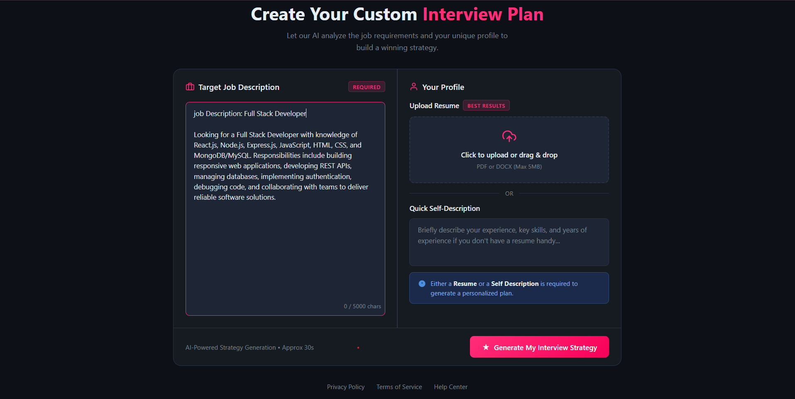
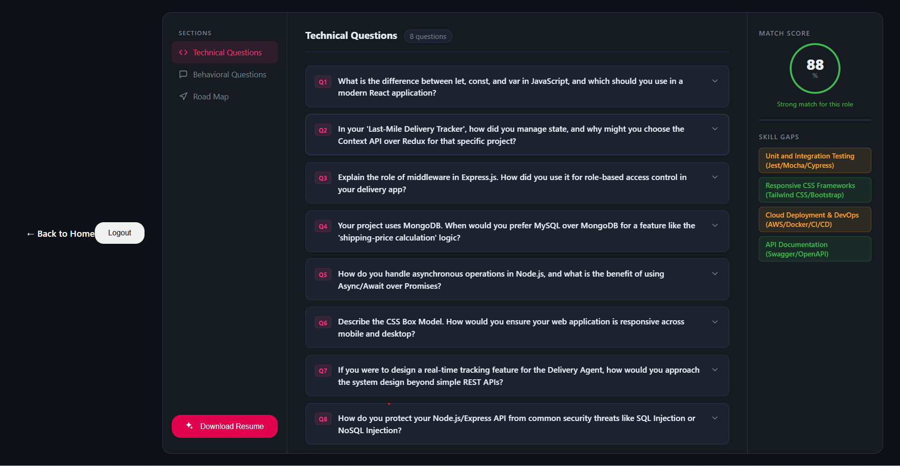
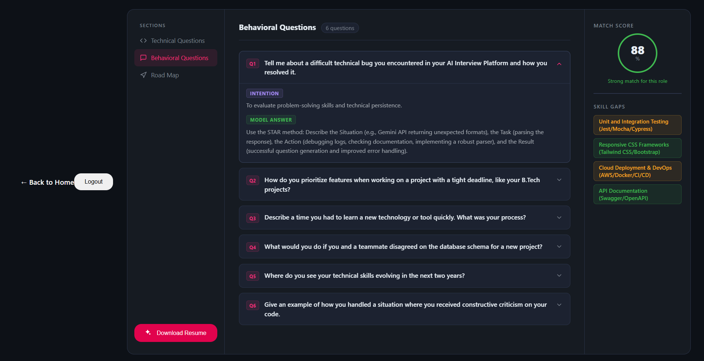
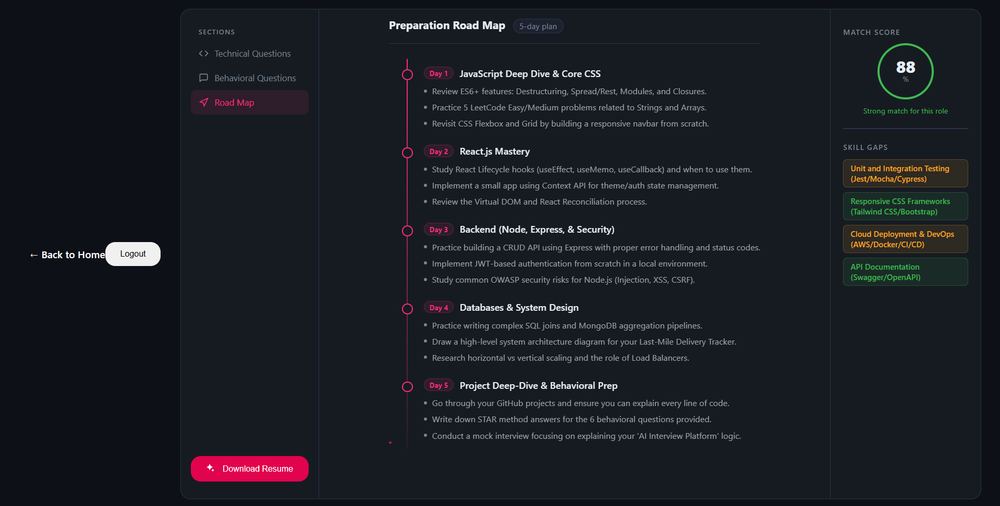

# AI Interview Preparation Platform

An AI-powered web application that helps candidates prepare for technical and behavioral interviews through resume analysis, job matching, skill-gap identification, and a personalized preparation roadmap.

## 🚀 Features

- **AI Resume Analysis:** Analyze a resume against a job description.
- **Job Match Score:** See how well your profile matches a target role.
- **Technical Interview Questions:** Practice AI-generated technical questions with model answers.
- **Behavioral Interview Questions:** Prepare for HR and behavioral rounds using the STAR method.
- **Skill Gap Analysis:** Identify skills that need improvement, with severity levels.
- **Preparation Roadmap:** Follow a day-by-day interview preparation plan.
- **Resume Download:** Generate a tailored resume PDF for the role.
- **User Authentication:** Register and log in securely with JWT.
- **Protected Routes:** Restrict access to authenticated users.
- **AI Integration:** Insights generated with the Google Gemini API.

## 📸 Screenshots

### 🏠 Home Page



### 💻 Technical Interview Questions



### 🗣️ Behavioral Interview Questions



### 🗺️ Preparation Roadmap



## 🛠️ Tech Stack

- **Frontend:** React.js, Vite, JavaScript, HTML5, CSS3, Sass
- **Backend:** Node.js, Express.js, REST APIs, JWT Authentication
- **Database:** MongoDB, Mongoose
- **AI Integration:** Google Gemini API
- **Tools:** Git, GitHub, VS Code, Postman

## 📁 Project Structure

```text
interview-ai-yt/
├── Backend/
│   ├── src/
│   │   ├── config/
│   │   ├── controllers/
│   │   ├── middlewares/
│   │   ├── models/
│   │   ├── routes/
│   │   ├── services/
│   │   └── app.js
│   ├── package.json
│   └── server.js
├── Frontend/
│   ├── src/
│   ├── public/
│   ├── package.json
│   └── index.html
├── screenshots/
│   ├── home.png
│   ├── technical-questions.png
│   ├── behavioral-questions.png
│   └── roadmap.png
├── .gitignore
└── README.md
```

## ⚙️ Installation and Setup

### Prerequisites

- Node.js 20.16+ or 22+
- npm
- MongoDB or a MongoDB Atlas database
- Google Gemini API key

### 1. Clone the Repository

```bash
git clone https://github.com/VaishnaviUbarhande/ai-interview-preparation-platform.git
cd ai-interview-preparation-platform
```

### 2. Set Up the Backend

```bash
cd Backend
npm install
```

Create a `.env` file inside the `Backend` folder with the following variables:

```env
MONGO_URI=your_mongodb_connection_string
JWT_SECRET=your_secure_random_secret
GOOGLE_GENAI_API_KEY=your_gemini_api_key
```

Start the backend server:

```bash
npm run dev
```

The backend server runs at `http://localhost:3000`.

### 3. Set Up and Run the Frontend

Open a **second terminal** in VS Code and run:

```bash
cd Frontend
npm install
npm run dev
```

Open the local URL displayed in the terminal, usually `http://localhost:5173`.

## 🔐 Security

- Store API keys and database credentials in environment variables.
- Never upload `.env` files or secrets to GitHub.
- Configure CORS to allow your frontend URL.
- Protect API endpoints that require authentication.

## 🔮 Future Improvements

- Interactive mock interview sessions.
- Improved resume-to-job-description matching.
- Progress tracking for interview preparation.
- More personalized skill recommendations.
- Enhanced dashboard and interview reports.

## 👩‍💻 Author

**Vaishnavi Ashok Ubarhande**

Computer Science and Engineering Student

## 📄 License

This project is intended for educational and learning purposes. Add a `LICENSE` file if you choose a specific open-source license.
